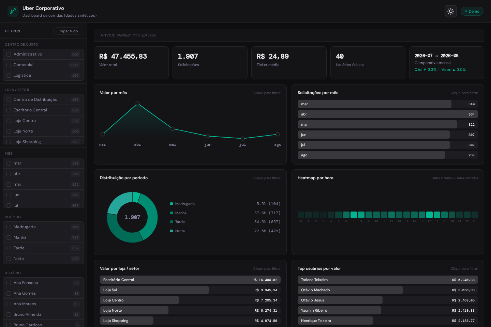
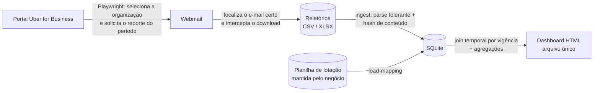

# Uber for Business: automação de relatórios, ETL e dashboard

[](https://github.com/DerickxP/uber-business-reports-automation/actions/workflows/ci.yml)


Pipeline ponta a ponta que **solicita e baixa os relatórios de viagens do Uber for Business**
para várias empresas, **consolida tudo em SQLite** de forma idempotente e **gera um dashboard
interativo em um único arquivo HTML**, sem servidor e sem bibliotecas externas.

> Este repositório é uma reconstrução, com dados sintéticos, de uma automação que desenvolvi
> em contexto corporativo. Nenhum dado real, nome de empresa, credencial ou sessão faz parte
> do código ou do histórico. A demonstração roda inteira sem acesso a nenhum portal.



---

## O problema

Uma empresa com várias razões sociais no Uber for Business precisa, todo mês, responder a
perguntas simples: quanto cada loja gastou com corridas, quem são os maiores usuários, em
que horários as corridas acontecem, o custo cresceu ou caiu em relação ao mês anterior.

Na prática, chegar a essas respostas era um processo manual e frágil:

- **O portal não exporta na hora.** Para cada empresa é preciso abrir o portal, escolher a
  organização, pedir um reporte com o período certo e esperar um e-mail com o link de
  download. Com N empresas, são N ciclos de espera e download, todo mês.
- **Os arquivos variam.** CSV ou XLSX, cabeçalhos com e sem acento, valores no formato
  brasileiro ("1.234,56"), horas como "14:35" ou "2:35 PM", linhas de metadados antes da
  tabela. Cada variação quebrava a planilha de consolidação.
- **Reimportar duplicava corridas.** Sem uma chave estável por corrida, qualquer reprocesso
  gerava contagens infladas.
- **O custo por loja saía errado.** As pessoas mudam de loja e de centro de custo ao longo
  do ano. Atribuir todas as corridas de alguém à lotação atual transfere o custo de meses
  passados para a loja nova.

## A solução



Cada etapa é um subcomando independente, o que permite rodar tudo de uma vez ou depurar
uma etapa isolada:

| Etapa | Comando | O que faz |
| --- | --- | --- |
| Sessão | `uber-reports save-session uber` / `mail` | Login manual, uma única vez; a sessão é reutilizada pelo robô |
| Extração | `uber-reports extract` | Solicita o reporte de cada empresa e baixa o arquivo pelo webmail |
| Ingestão | `uber-reports ingest` | Lê os relatórios, normaliza e grava as corridas no SQLite |
| Lotação | `uber-reports load-mapping` | Carrega pessoas e histórico de lotação da planilha |
| Dashboard | `uber-reports dashboard` | Gera o HTML interativo a partir do banco |
| Tudo | `uber-reports pipeline` | Executa as etapas acima em sequência |
| Demo | `uber-reports demo` | Gera dados sintéticos e roda o pipeline inteiro sem portais |

## Arquitetura

```text
src/uber_reports/
├── cli.py                  # subcomandos; cada etapa pode rodar isolada
├── config.py               # config.json validado em dataclasses; sem segredos
├── automation/             # camada de navegador (Playwright)
│   ├── sessions.py         #   captura de sessão de login (storage_state)
│   ├── uber_portal.py      #   portal: organização, relatórios, período, solicitação
│   ├── mailbox.py          #   webmail: busca, abre o e-mail certo, intercepta o download
│   ├── extractor.py        #   orquestra portal + webmail e trata falhas (screenshot)
│   └── text.py             #   normalização de texto lido das páginas
├── etl/                    # camada de dados
│   ├── reports.py          #   leitura tolerante dos relatórios exportados
│   ├── parsing.py          #   funções puras: valores BRL, horas, datas, hash da corrida
│   ├── schema.py           #   DDL do SQLite
│   └── load.py             #   upsert de corridas e carga da planilha de lotação
├── dashboard/              # camada analítica e de apresentação
│   ├── queries.py          #   join temporal corrida x lotação vigente
│   ├── render.py           #   monta o HTML único a partir dos assets
│   └── assets/             #   template.html, styles.css, app.js (gráficos em SVG puro)
└── demo/
    └── synthetic.py        # dados sintéticos com "verdade" conhecida para os testes
```

As três camadas não se conhecem: a automação só produz arquivos, o ETL só lê arquivos e
escreve no banco, o dashboard só lê o banco. Trocar o portal, a fonte da lotação ou a
visualização não exige mexer nas outras camadas.

## Decisões de projeto

**Sessão salva em vez de login automatizado.** Automatizar usuário e senha é frágil (2FA,
captcha, bloqueio por comportamento suspeito) e obriga a guardar credenciais. O robô
reutiliza o `storage_state` de um login feito manualmente uma vez. Os arquivos de sessão
são tratados como credencial: ficam fora do git e fora da configuração.

**Seletores que sobrevivem a mudanças de interface.** O portal alterna pt-BR e inglês e
varia a acentuação dos rótulos. Todo texto lido é comparado sem acentos e em caixa alta, e
cada ação tem alternativas com fallback (menu lateral ou URL direta, botão por papel ou por
texto, corpo do e-mail na página ou em iframe). O link de download abre em nova aba; o
atributo `target` é removido para que o Playwright intercepte o download na mesma página.

**Cabeçalho localizado por conteúdo.** O arquivo exportado tem um bloco de metadados
antes da tabela. Em vez de pular um número fixo de linhas, o leitor procura a linha que
contém "Nome" e "Sobrenome" e detecta o separador a partir dela.

**Idempotência por hash de conteúdo.** Cada corrida recebe um SHA-1 dos campos que a
identificam (pessoa, data, hora, valor, serviço, cidade). Reimportar o mesmo relatório, ou
um relatório de período sobreposto, não duplica nada: o `INSERT ... ON CONFLICT` atualiza a
linha existente. Endereços ficam fora do hash de propósito, porque o portal os reformata
entre exportações.

**Lotação com vigência, não lotação atual.** A planilha mantida pelo negócio informa em
que loja e centro de custo cada pessoa esteve, com data de início e fim. A consulta do
dashboard faz um join temporal: cada corrida recebe a lotação válida na data da corrida.
Quem foi transferido em julho tem junho contabilizado na loja antiga e julho na nova.

```sql
LEFT JOIN assignment_history a
  ON a.id = (
      SELECT a2.id FROM assignment_history a2
      WHERE a2.employee_id = r.employee_id
        AND date(r.ride_date) >= date(a2.valid_from)
        AND (a2.valid_to IS NULL OR date(r.ride_date) <= date(a2.valid_to))
      ORDER BY a2.valid_from DESC, a2.id DESC
      LIMIT 1
  )
```

**Planilha como fonte da verdade da lotação.** Quem sabe onde cada pessoa está lotada é o
RH ou o gestor, não o código. A cada carga, as tabelas de pessoas e vigências são recriadas
a partir da planilha, então corrigir um erro é editar a planilha e rodar de novo.

**Dashboard em um único arquivo, sem dependências.** Os dados vão embutidos como JSON e os
gráficos (linha, barras, rosca, heatmap) são SVG gerado por JavaScript puro, com filtros
cruzados entre todas as dimensões. O HTML pode ser enviado por e-mail ou aberto de uma
pasta de rede, sem servidor, sem instalação e sem depender de CDN.

**Dados sintéticos com verdade conhecida.** O gerador cria relatórios no layout exato do
portal e a planilha de lotação correspondente, incluindo pessoas transferidas de loja no
meio do período. Como o gerador sabe onde cada pessoa estava em cada data, o teste
ponta a ponta confere que o join temporal reproduz essa verdade corrida por corrida.

## Como rodar

### Demonstração (sem acesso a nenhum portal)

```bash
pip install -e ".[dev]"
uber-reports demo --output-dir demo_output
```

Abra `demo_output/dashboard.html` no navegador. O comando gera seis meses de relatórios
sintéticos para duas empresas, a planilha de lotação, o banco SQLite e o dashboard.

### Uso real

1. Instale o navegador do Playwright: `playwright install chromium`.
2. Copie `config.example.json` para `config.json` e informe as empresas, o provedor de
   e-mail e os caminhos. O arquivo não contém segredos.
3. Salve as sessões, uma única vez: `uber-reports save-session uber` e
   `uber-reports save-session mail`. O navegador abre, você faz login e pressiona ENTER.
4. Mantenha a planilha de lotação em `data/mapping.xlsx` (formato abaixo).
5. Rode `uber-reports pipeline`. Para reprocessar arquivos já baixados sem abrir o
   navegador, use `uber-reports pipeline --skip-extract`.

Para agendar, chame `uber-reports pipeline` a partir do cron ou do Agendador de Tarefas.

### Planilha de lotação

| Aba | Colunas | Observação |
| --- | --- | --- |
| `Funcionarios` | Nome, Sobrenome, Centro de Custo, Setor/Loja | Lotação atual. Obrigatória. |
| `HistoricoUsuarios` | Nome, Sobrenome, Centro de Custo, Setor/Loja, Data Inicio, Data Fim | Vigências. Opcional; sem ela, a lotação atual vale para todo o histórico. |

Os nomes de abas e colunas aceitam variações de acento e caixa (por exemplo `Usuarios`,
`Início`, `Vigência Fim`).

## Modelo de dados

| Tabela | Chave | Conteúdo |
| --- | --- | --- |
| `rides` | `ride_id` (SHA-1 de conteúdo) | Uma linha por corrida: pessoa, data, hora, valor, serviço, cidade, endereços, empresa, arquivo de origem |
| `employees` | `employee_id` (nome normalizado) | Cadastro mínimo de pessoas |
| `assignment_history` | `id`, único por (pessoa, centro de custo, loja, início) | Lotação com `valid_from` e `valid_to` |

Detalhes em [docs/data-model.md](docs/data-model.md) e [docs/architecture.md](docs/architecture.md).

## Testes e CI

```bash
ruff check .
pytest
```

A suíte cobre parsing (valores, horas, datas, colunas com e sem acento), leitura dos
relatórios (detecção de cabeçalho e separador, linhas inválidas), idempotência da carga,
carga da planilha com e sem histórico, o join temporal (inclusive vigências sobrepostas),
a geração do HTML (escape de dados, placeholders) e o pipeline ponta a ponta com dados
sintéticos. O GitHub Actions roda lint, testes e a demo em Python 3.10 e 3.12.

A camada de automação depende de sessões reais e da interface do portal, por isso não é
exercitada em CI. Ela é isolada do restante justamente para que tudo o que pode ser
testado sem o portal seja testado.

## Limitações e evolução

- Mudanças na interface do portal ou do webmail podem exigir ajuste de seletores. A
  normalização de texto e os fallbacks reduzem, mas não eliminam, esse risco.
- O join temporal escolhe a vigência mais recente quando há sobreposição; a planilha deve
  evitar vigências que se cruzam.
- Próximos passos naturais: exportar para Parquet/DuckDB para volumes maiores, alertas de
  variação mensal por loja e gravação de HAR das páginas para testar a automação offline.

## Licença

MIT. Veja [LICENSE](LICENSE).
